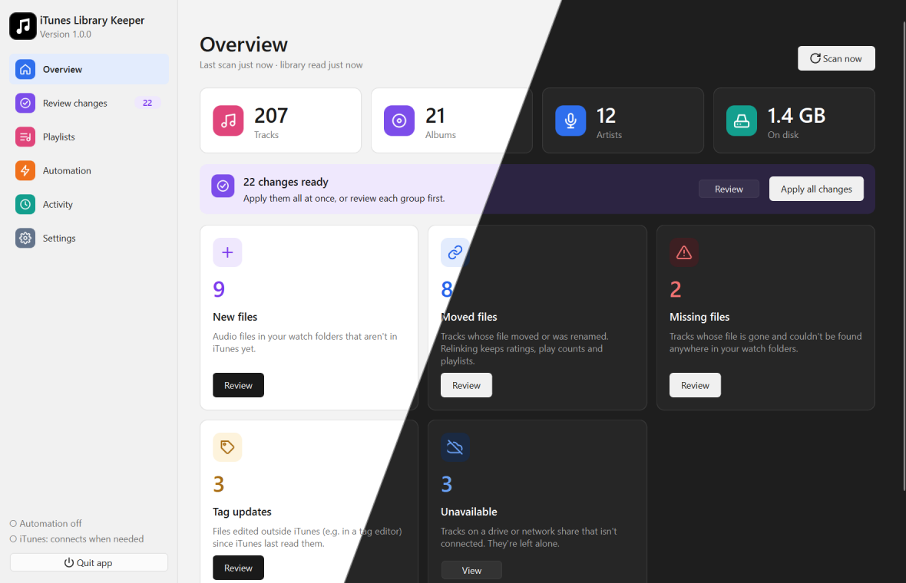
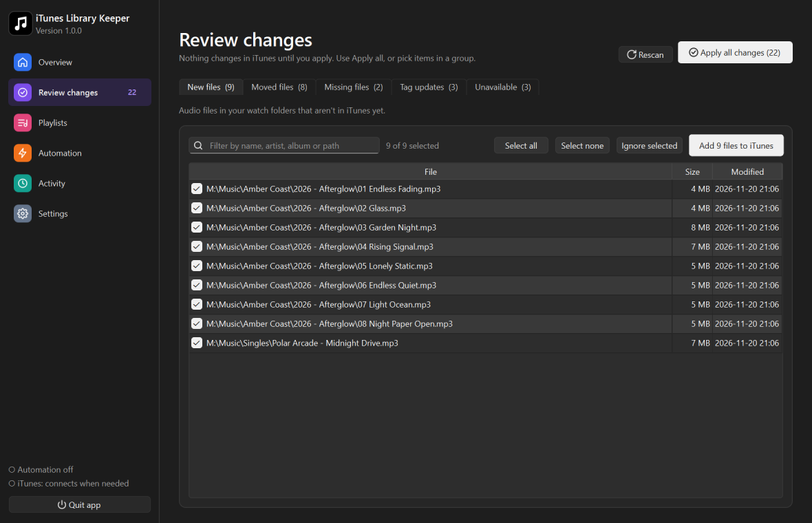
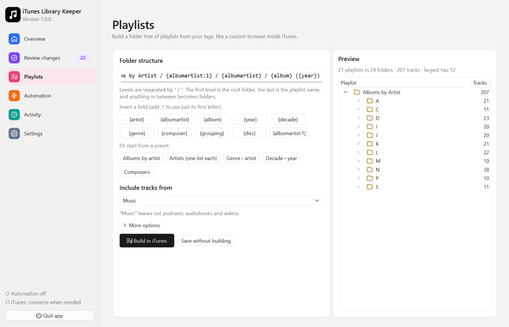

# iTunes Library Keeper

A replacement for klarita.net's *iTunes Library Toolkit* with a review-first workflow.
It keeps iTunes for Windows in step with the music folders on your disk.

**Version 1.0.1** · Created by **Faris Aljanubi** · Licence: [GPL-3.0](LICENSE) · **[Documentation](https://faljanubi.github.io/itunes-library-keeper/)**



## Download

Get the latest version from the **[Releases page](https://github.com/faljanubi/itunes-library-keeper/releases/latest)**:

- **`iTunesLibraryKeeper-<version>-setup.exe`**: installer with a Start menu shortcut and an uninstaller.
  It installs for your user account only, so it doesn't ask for admin rights.
- **`iTunesLibraryKeeper-<version>-portable-win64.zip`**: no install. Unzip it anywhere and run
  `iTunes Library Keeper.exe`. It keeps its settings in a `data` folder beside the .exe.

Neither needs Python. The files aren't code-signed, so Windows SmartScreen may show
*"Windows protected your PC"* the first time. Click **More info → Run anyway**.

## Requirements

- **Windows 10 or 11, 64-bit**
- **iTunes for Windows**, either from [apple.com](https://www.apple.com/itunes/) or the Microsoft Store. The app drives it through iTunes' COM API.
- In iTunes: *Edit > Preferences > Advanced >* tick **"Share iTunes Library XML with other applications"**. The app shows a red warning with these steps if it is off.

Back up your iTunes library folder before the first large clean-up.

## Using it

- Start **iTunes Library Keeper** from the Start menu (or `iTunes Library Keeper.exe` in the portable folder). It opens in its own window. It's a native Windows app built with Qt, in the Windows 11 style, so it follows the Windows light/dark setting unless you pick one in Settings.
- On first run, choose the folder(s) where your music lives; adding a folder runs a first scan. Opening the app doesn't start a scan; click **Scan now** when you want to check (or turn on automation). Scanning only reads; nothing in iTunes changes until you confirm. Click **Apply all changes** to apply everything at once, or pick individual items on the Review page.
- Closing the window quits the app (after any running task finishes).
  If **automation** is on, it keeps running in the **notification area** (system tray) instead; open it again from the tray icon, or stop it with **Quit app** at the bottom of the sidebar or the tray icon's menu.
- Starting the app while it's already running just brings the open window to the front.
- **Automation > Start with Windows** adds a Startup shortcut that starts it quietly in the notification area.

| Review | Playlists |
|---|---|
|  |  |

## What's different from the original

| Original | iTunes Library Keeper |
|---|---|
| Runs tasks blindly, shows a log afterwards | **Scan, then review**: every proposed change is listed, preselected sensibly, and nothing happens until you click Apply |
| Moved files: delete the old entry, re-add the file, copy some stats over | **Relinks in place** (`IITFileOrCDTrack.Location`), keeping ratings, play counts, date added *and playlist membership* |
| Changes often only show in iTunes after restarting it | Moved tracks are re-read from the file, and the open iTunes view is **refreshed automatically** after every change |
| Moved-file matching by Artist/Album/Title key (and a bug that ignores the digit 9) | Matches on file name + size. Ambiguous matches are never guessed; you pick from the candidates |
| A disconnected drive can make tracks look dead | Unavailable drives are reported separately and never treated as missing |
| Playlist template with cryptic `%AA1` codes, no preview | `{albumartist:1}` fields, presets, and a **live preview tree** with counts before anything is built |
| Re-running can duplicate playlists if the XML is stale | Sync reads the current tree from iTunes and only adds/removes the differences |
| Automation can mass-delete | Automatic removal is off by default and refuses to remove more than 25 at once |
| Licence nags, telemetry ping, ban-list download | None. Nothing leaves your machine, and no local web server is opened |
| No undo trail | **Activity** history with per-run logs; removed entries are saved to JSON first |

The HTML catalog generator isn't ported yet.

## Where things live

- Settings, history, ignore list, removal backups: `%APPDATA%\iTunesLibraryKeeper\` (moved over automatically from `LibraryToolkit` if you used the app under its old name)
- Log file: `%APPDATA%\iTunesLibraryKeeper\toolkit.log`

## Run from source

Needs **Python 3.10+** (64-bit) from [python.org](https://www.python.org/downloads/) or the Microsoft Store.

```bat
git clone https://github.com/faljanubi/itunes-library-keeper.git
cd itunes-library-keeper
setup.cmd
```

`setup.cmd` creates a private environment in `.venv` and installs the dependencies from `requirements.txt` (`pywin32` and `PySide6-Essentials`, the Qt toolkit the window is built with).
Then double-click **`iTunes Library Keeper.cmd`**, or run `python -m toolkit` (add `--background` to start in the notification area only).

If it stops starting (for example after files in `.venv` were deleted), quit it and run `setup.cmd` again. If that fails, delete the `.venv` folder first.

## Layout

```
toolkit/
  library.py    reads the iTunes XML; keeps an overlay of our own changes until iTunes rewrites it
  scan.py       finds new / moved / missing / unavailable / stale-tag tracks (read-only)
  itunes.py     COM wrapper with retry while iTunes is busy (open dialog)
  playlists.py  template engine, preview, and incremental sync
  jobs.py       single worker thread that owns the COM connection; progress + cancel
  app.py        actions, history, automation pipeline
  watcher.py    folder change notifications (debounced) + schedule
  startup.py    the "Start with Windows" shortcut
  gui/          the window (PySide6 / Qt Widgets, Windows 11 style)
    main.py       main window, sidebar, progress bar, notification-area icon, single instance
    pages.py      Overview and Review pages, Apply-all dialog
    pages_more.py Playlists, Automation, Activity and Settings pages
    widgets.py    cards, banners, toasts, icons, formatting helpers
    theme.py      light/dark colours for the app's own elements
```

## Problems and ideas

Please open an [issue](https://github.com/faljanubi/itunes-library-keeper/issues). Include the app version
(Settings > About), your Windows version, and the relevant lines from
`%APPDATA%\iTunesLibraryKeeper\toolkit.log` (or `data\toolkit.log` in the portable folder).

## Licence

Copyright © 2026 Faris Aljanubi.

iTunes Library Keeper is free software: you can redistribute it and/or modify it under the terms of the
[GNU General Public License version 3](LICENSE) or (at your option) any later version. It comes with
**no warranty**. The release builds also contain Python, Qt for Python (PySide6, LGPL-3.0) and pywin32,
each under its own licence.

## Disclaimer

Not affiliated with Apple or klarita.net. iTunes is a trademark of Apple Inc.
The app changes your iTunes library only when you confirm (or when you enable automation), but back up your library before large operations.

## Build a standalone .exe

Run `build.cmd`. It creates a build environment with PyInstaller and outputs
`dist\iTunes Library Keeper\iTunes Library Keeper.exe`, which runs without Python installed. Zip the
`iTunes Library Keeper` folder to share it, for example as a GitHub Release asset.

### Release: portable zip + installer

Run `release.cmd` (needs [Inno Setup 6](https://jrsoftware.org/isinfo.php): `winget install JRSoftware.InnoSetup`).
It runs `build.cmd` and then makes both versions in `dist\`:

- **`iTunesLibraryKeeper-<version>-portable-win64.zip`**: no install. The compiled .exe keeps its settings in a
  `data` folder next to itself unless Setup installed it (an Inno Setup uninstaller beside it, or an uninstall
  entry for the app pointing at its folder); on first start it copies existing `%APPDATA%` settings, if any.
  Window size is kept in `data\window.ini` instead of the registry. Running from source always uses `%APPDATA%`.
  `assets\README.txt` goes in as its README.
- **`iTunesLibraryKeeper-<version>-setup.exe`**, from `installer\iTunesLibraryKeeper.iss`: installs for the current
  user without an admin prompt (or for all users if chosen), adds Start menu / optional desktop shortcuts and an
  uninstaller, and closes a running copy first (`--quit`). Uninstalling asks whether to also delete the settings
  in `%APPDATA%\iTunesLibraryKeeper`.

To release a new version, change `VERSION` in `toolkit/version.py` and the four version numbers in
`assets/version_info.txt` (shown in the .exe's Properties > Details) and the version line in `assets/README.txt`,
then run `release.cmd`.
